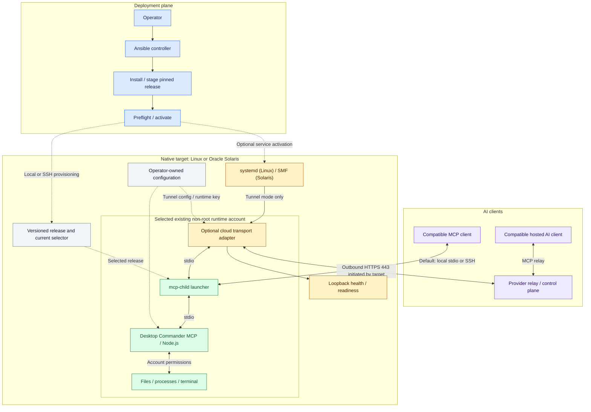

# Desktop Commander MCP Playbook

[](https://www.ansible.com/)
[](https://www.python.org/)
[](https://yaml.org/)
[](https://www.gnu.org/software/bash/)
[](https://developer.mozilla.org/en-US/docs/Web/JavaScript)
[](https://modelcontextprotocol.io/)
[](#support-and-limitations)
[](docs/solaris-portability.md)
[](LICENSE)

**Deploy native MCP infrastructure for AI-assisted systems engineering, software development and operations.**

Desktop Commander MCP Playbook is vendor-neutral Infrastructure as Code for
installing and operating [Desktop Commander](https://github.com/wonderwhy-er/DesktopCommanderMCP)
on Linux and Oracle Solaris. It turns a supported physical server or virtual
machine into an MCP-capable execution environment, with explicit account
selection, pinned releases and documented operational controls.

The core uses the open [Model Context Protocol (MCP)](https://modelcontextprotocol.io/)
over standard `stdio`. Compatible AI clients can launch the server locally
or through existing authenticated SSH. An optional cloud connectivity
adapter provides an outbound relay for compatible hosted clients without
exposing a public inbound MCP endpoint. No provider account or
vendor-specific relay is required for the default transport.

Use cases include remote development, software packaging, infrastructure
maintenance and troubleshooting on systems you administer.

[Architecture](#architecture) · [Platform support](#support-and-limitations) ·
[Installation](#1-configure-ansible) · [AI client configuration](#3-configure-compatible-ai-agents) ·
[Security](docs/security.md) · [Validation](docs/validation.md)

## What the playbook provides

| Capability | Implementation |
| --- | --- |
| Infrastructure as Code | Ansible roles and playbooks for installation, preflight, activation and removal |
| Native deployment | Linux systemd and Oracle Solaris SMF for the optional tunnel; no container runtime required |
| Vendor-neutral MCP | Local or SSH-launched stdio by default, optional provider-specific adapter |
| Release management | Pinned source revisions, lockfile and artifact checks, versioned releases and explicit selection |
| Account boundaries | Existing non-root account, per-user paths, no account creation or sudoers modification |
| Operational safeguards | Offline preflight, local readiness checks, guarded Linux tunnel upgrades and passive Linux monitoring |
| Engineering validation | Python unit tests, Ruff, ansible-lint, syntax checks and documented native integration evidence |

## Architecture

The deployment plane provisions the target; the runtime plane handles MCP
requests. The two transport paths are alternative configurations for a managed
account, not dependencies of one another. The diagram describes the
provider-neutral design; cloud connectivity requires a supported adapter.



**Default path:** the MCP client starts the launcher on demand. No background
service, runtime API key or provider control plane is required.

**Optional cloud path:** the service manager starts the tunnel client under
the selected account. The client initiates an outbound HTTPS connection and
launches Desktop Commander over stdio; health endpoints remain local.
This path requires a compatible implemented relay; it is not a universal
cloud connector. See the [available adapter](docs/openai-tunnel.md).

Linux uses system-managed versioned releases and per-account selectors;
Solaris uses an account-owned release layout and local Ansible. See the
[Cloud adapter guide](docs/openai-tunnel.md) and [Solaris guide](docs/solaris-portability.md)
for platform-specific setup.

> **Security boundary:** MCP tools operate with the selected account's existing
> privileges. This is not a sandbox. The playbook never grants sudo privileges
> or creates accounts. Review [security boundaries](docs/security.md) before
> authorizing agent access.

## Support and limitations

| Item | Current support |
| --- | --- |
| Server protocol | Standard MCP over `stdio` (default) |
| Optional remote access | Existing authenticated SSH, or an explicitly configured [cloud adapter](docs/openai-tunnel.md) |
| AI clients | Any client that can launch a standards-compliant stdio MCP subprocess; [configuration examples](docs/ai-clients.md); client-specific end-to-end validation varies |
| Platforms | Native Ubuntu 26.04, RHEL 10, Fedora 43/44 and Arch/Omarchy; x86_64 or aarch64, glibc and systemd |
| Solaris | Local Ansible installation and stdio validated on Oracle Solaris 11.4.90 CBE x86-64. Optional SMF boot activation is described in [Solaris setup](docs/solaris-portability.md#run-your-own-openai-tunnel). |
| Components pinned | Desktop Commander 0.3.4, Node 24.21.0 on Linux and system Node on Solaris; optional tunnel-client 0.0.16 (see [adapter guide](docs/openai-tunnel.md)) |
| Ansible | Controller ansible-core 2.21.x, `community.general` 13.5.0 for pacman |

MCP has standard `stdio` and Streamable HTTP transport bindings. This role
implements **stdio only** for vendor-neutral use; it does not expose an HTTP
MCP endpoint. A remote, browser-only service cannot connect directly to a
private SSH-stdio host without an appropriate supported bridge. Do not mistake
model/vendor compatibility for network reachability or an automatic cloud
connector. See the [MCP transport specification](https://modelcontextprotocol.io/specification/2025-11-25/basic/transports).

### Installation compatibility

This is a **breaking installer architecture**. Older managed installations and
release manifests are **not migrated or supported**. Existing operators must
plan a manual deactivation, removal and fresh installation; never run the new
role over an active old tunnel expecting an in-place upgrade. The playbook
rejects incompatible transport layouts instead of trying to convert them.

The [validation history](docs/validation.md) distinguishes historical native
Linux tunnel tests from the current transport architecture. The
[Solaris guide](docs/solaris-portability.md) records native stdio and foreground
tunnel validation on Solaris 11.4.90 CBE x86-64. Fedora and arm64 are
implemented target paths, not fully validated native deployments.

## 1. Configure Ansible

For Solaris, follow the [local Ansible setup](docs/solaris-portability.md)
instead of the Linux commands below.

On a supported Ansible controller, clone the repository and install the
pinned development tools and collections:

```bash
git clone https://github.com/johngrimmreaper/desktop-commander-mcp-playbook.git
cd desktop-commander-mcp-playbook
python3 -m venv .venv
.venv/bin/python -m pip install -r requirements-dev.txt
.venv/bin/ansible-galaxy collection install -r collections/requirements.yml
cp -n inventory/hosts.example.yml inventory/hosts.yml  # remote SSH deployment
# Or use inventory/local.example.yml for a native local deployment.
vi inventory/hosts.yml
.venv/bin/python scripts/validate-inventory.py
```

The ignored `inventory/hosts.yml` must identify the **existing non-root**
`dcmcp_user`. For a local host, use the local inventory example, with
`ansible_connection: local` and `/usr/bin/python3`.

```yaml
all:
  children:
    mcp_servers:
      hosts:
        my_server:
          ansible_host: server.example.net
          ansible_user: ssh_operator
          ansible_python_interpreter: /usr/bin/python3
          dcmcp_user: mcp_operator
          dcmcp_transport: stdio
```

The runtime user is not necessarily the SSH/Ansible operator. All playbooks
run serially and preserve that user's existing Linux permissions. For sudo
password prompting, supply `--ask-become-pass` on the controller. Never place
passwords or API keys in inventory.

`dcmcp_transport` defaults to `stdio`; the explicit setting above is for
readability. You may omit it. Choose an optional transport only when your
client requires a compatible relay; see the [available adapter setup](docs/openai-tunnel.md).

## 2. Install, configure and activate standard MCP

Install the immutable, checksum-verified Desktop Commander and Node release:

```bash
.venv/bin/ansible-playbook playbooks/install.yml
```

**Install stages files; it does not start an MCP server.** The active
Desktop Commander settings are deliberately created manually. Log in as the
selected `dcmcp_user` on the target, then:

```bash
umask 077
cp -n "/usr/local/share/desktop-commander-mcp/$(id -un)/desktop-commander.json.example" \
  "$HOME/.claude-server-commander/config.json"
chmod 600 "$HOME/.claude-server-commander/config.json"
vi "$HOME/.claude-server-commander/config.json"
```

The directory `.claude-server-commander` is **Desktop Commander's upstream
settings directory**, not a provider-specific transport or dependency. The
sample is deliberately permissive: `allowedDirectories: []` and
`blockedCommands: []` do **not** constrain the existing Linux identity.
Review [security boundaries](docs/security.md) before granting agent access.

Then, back on the controller:

```bash
.venv/bin/ansible-playbook playbooks/preflight.yml
.venv/bin/ansible-playbook playbooks/activate.yml
```

This verifies the installed release and private configuration and atomically
selects the release. It does **not** start a background daemon in `stdio` mode.

The selected account's stdio entrypoint is:

```text
/usr/local/libexec/desktop-commander-mcp/USER/mcp-child
```

The MCP client launches it under `USER` on demand. An authorized client on
another machine may use:

```bash
ssh -T -o BatchMode=yes USER@YOUR_HOST \
  /usr/local/libexec/desktop-commander-mcp/USER/mcp-child
```

The SSH key, target account and host-key policy must already be configured;
no password prompts or SSH banners may contaminate the MCP protocol stream.
The launcher verifies that it is running under the expected Unix UID.

## 3. Configure compatible AI agents

Register a **stdio** MCP server in any compatible client using the launcher
command and arguments above. The local and SSH connection patterns do not
depend on a particular AI provider. Client-specific configuration formats
and network access requirements vary.

See [AI client configuration examples](docs/ai-clients.md) for illustrative
CLI configurations and the optional cloud connectivity guide. The examples
are non-exhaustive; protocol compatibility does not imply end-to-end
validation of every client.

## 4. Operations and adapters

- **Stdio upgrade**: update reviewed upstream pins and checksums, run
  `install.yml`, `preflight.yml`, and `activate.yml`. Existing MCP clients may
  finish or be restarted independently. Use an independent SSH/console shell
  for deployment.
- **Optional cloud transport**: select the supported adapter as documented in
  the [separate adapter guide](docs/openai-tunnel.md). On Linux that
  transport supports a persistent systemd service and optional passive health
  monitor; the operator provisions the runtime key. `upgrade.yml` and
  `doctor.py` cover the Linux tunnel lifecycle. Solaris uses SMF; see its guide.
- **Uninstall**: `playbooks/uninstall.yml` removes managed per-user files and
  optional systemd units while preserving the account home, manually created
  configuration and keys, and shared versioned release caches.
- **Run checks**: `.venv/bin/python scripts/check.py` runs unit tests, Ruff,
  ansible-lint and the playbook syntax checks without deploying. Host-changing
  integration tests are separate and must be executed only on an authorized
  disposable test VM.

No automatic migration is implemented. To change an account from an existing
transport or an older installation, stop/deactivate that service from an
independent session, remove the managed installation deliberately, review the
preserved account files, and install the desired transport afresh. Back up
runtime credentials and configuration before making those manual changes.

## Extensibility and further reading

The generic MCP protocol is vendor-neutral. Native packages, Node dependencies
and service management vary by platform. The Solaris setup documents the
native build and SMF activation steps. [Solaris setup](docs/solaris-portability.md)

Additional distribution backends and optional provider-specific relays should
reuse the same MCP build, security, non-root execution and stdio contract,
without hard-coding a vendor into the installer. Do not add new integrations
without their own documented configuration and native tests.

- [Current and historical validation](docs/validation.md)
- [Upstream source and pins](docs/upstream.md)
- [Omarchy deployment notes](docs/omarchy.md)
- [Security](docs/security.md)
- [LICENSE](LICENSE)
